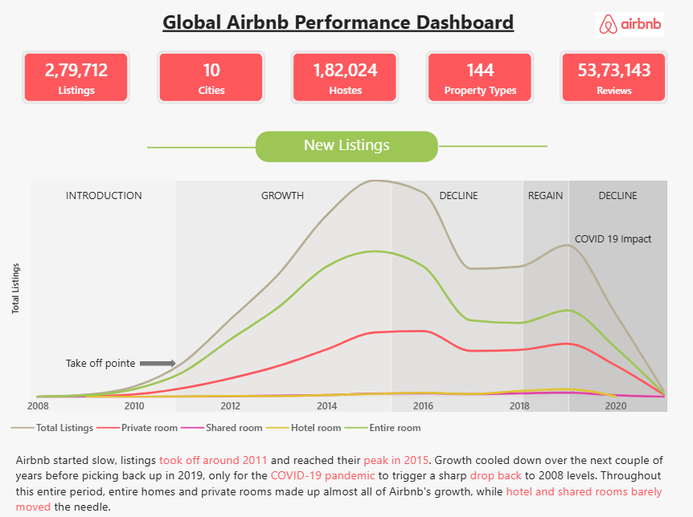

# Global Airbnb Performance Dashboard

An interactive Power BI dashboard analyzing Airbnb listing growth,
city-level market distribution, accommodation pricing, host status, and
guest review scores across 10 cities.

> **Project type:** Data Analytics / Business Intelligence\
> **Tool:** Microsoft Power BI Desktop\
> **Dataset source:** Maven Analytics\
> **Report experience:** Overview and Detailed View (bookmark-based
> navigation)

## Dashboard Preview

Add the exported dashboard screenshots to the `Screenshots` folder and
keep these image paths, or update them to match your filenames.

### 1. Listings Growth



### 2. City Market Share, Pricing and Reviews


## Project Overview

This project uses Power BI to explore Airbnb performance across 10
cities. The dashboard brings together listing trends, city-level
comparisons, accommodation prices, host status, and guest review scores.

The goal is to turn the dataset into an easy-to-explore report that
helps users understand where listings are concentrated, how the listing
mix has changed over time, and how accommodation categories compare.

## Key Metrics

The dashboard displays these headline figures:

  Metric             Value
  ---------------- --------------------------
  Listings                            279,712
  Cities                                   10
  Hosts                               182,024
  Property Types                          144
  Reviews                           5,373,143

These values reflect the dataset/report snapshot used for this project,
not live Airbnb figures.

## Dashboard Walkthrough

### Page 1 --- Listings Growth

This page focuses on how Airbnb listings changed over time.

It includes: - Total listings over time. - A comparison of entire
places, private rooms, shared rooms, and hotel rooms. - Timeline
annotations for introduction, growth, decline, regain, and decline
phases. - A highlighted COVID-19 impact period.

**Observations presented in the dashboard:** - Listings began growing
more rapidly around 2011. - The chart shows a peak around 2015. - Growth
slowed in the following years, picked up again around 2019, and then
declined sharply during the COVID-19 period. - Entire places and private
rooms account for most of the visible listing growth.

### Page 2 --- City Market Share, Pricing and Reviews

This page compares the 10 cities included in the report.

It includes: - A city-level listing comparison split by Superhost and
non-Superhost. - A cumulative-percentage line. - Average nightly price
comparisons by accommodation category, displayed in USD. - Average
review-score comparisons across cities, measured out of 100. - Overview
and Detailed View navigation.

**Observations presented in the dashboard:** - Paris, New York, and
Sydney are highlighted as the core market cluster, accounting for nearly
50% of total listings and aggregate review volume. - Paris is identified
as the leading city by listing inventory. - Hotel rooms show the highest
displayed average nightly price, while private rooms show the lowest. -
Average review scores across the 10 cities range from 90 to 95 out of
100.

### Pricing Comparison

  Accommodation category     Average nightly price shown
  ------------------------ -----------------------------
  Hotel room                                       \$800
  Entire place                                     \$673
  Shared room                                      \$580
  Private room                                     \$462

*Prices are shown in USD, as represented in the dashboard.*

## Business Questions Explored

1.  How did Airbnb listing volume change over the years shown?
2.  Which accommodation categories contributed most to listing growth?
3.  Which cities account for the largest share of listings?
4.  How do Superhost and non-Superhost listings compare across cities?
5.  How do average nightly prices differ by accommodation category?
6.  How do average review scores compare across cities?

## Tools and Technical Work

-   **Microsoft Power BI Desktop** --- report creation and
    visualization.
-   **Power Query** --- basic data preparation and transformation.
-   **DAX** --- measures and calculations used in the report.
-   **Data modeling** --- relationships created between tables.
-   **Bookmarks** --- used to switch between the Overview and Detailed
    View experiences.
-   **Data visualization** --- KPI cards, trend charts, city
    comparisons, pricing bars, and review-score charts.

## Key Takeaways

Based on the observations shown in the dashboard:

-   Airbnb listing growth accelerated around 2011 and reached a visible
    peak around 2015.
-   Entire places and private rooms account for most of the listing
    growth shown.
-   Paris, New York, and Sydney form the leading market cluster
    highlighted in the report.
-   Hotel rooms have the highest displayed average nightly price
    (\$800), while private rooms have the lowest (\$462).
-   Average review scores across the selected cities range from 90 to 95
    out of 100.


## Repository Structure

``` text
.
├── Assets
├── Dashboard/
│   ├── AirBnb_Global_Performance_Dashboard.pdf  
├── Screenshots/
│   ├── 01-listings-growth.png
│   └── 02-city-market-share-pricing-reviews.png
└── README.md
```


## Dataset

**Source:** Maven Analytics

[Dataset link](https://mavenanalytics.io/data-playground/airbnb-listings-reviews)

## Feedback

I welcome feedback on the dashboard design, data modeling, DAX
calculations, and the business questions explored in this project.

------------------------------------------------------------------------

**Created by:** Rahul Singh Gour  
**LinkedIn:** [Rahul Singh Gour](https://www.linkedin.com/in/rahulsinghgour?utm_source=share_via&utm_content=profile&utm_medium=member_android)  
**GitHub:** [rahulsinghgour-star](https://github.com/rahulsinghgour-star)
